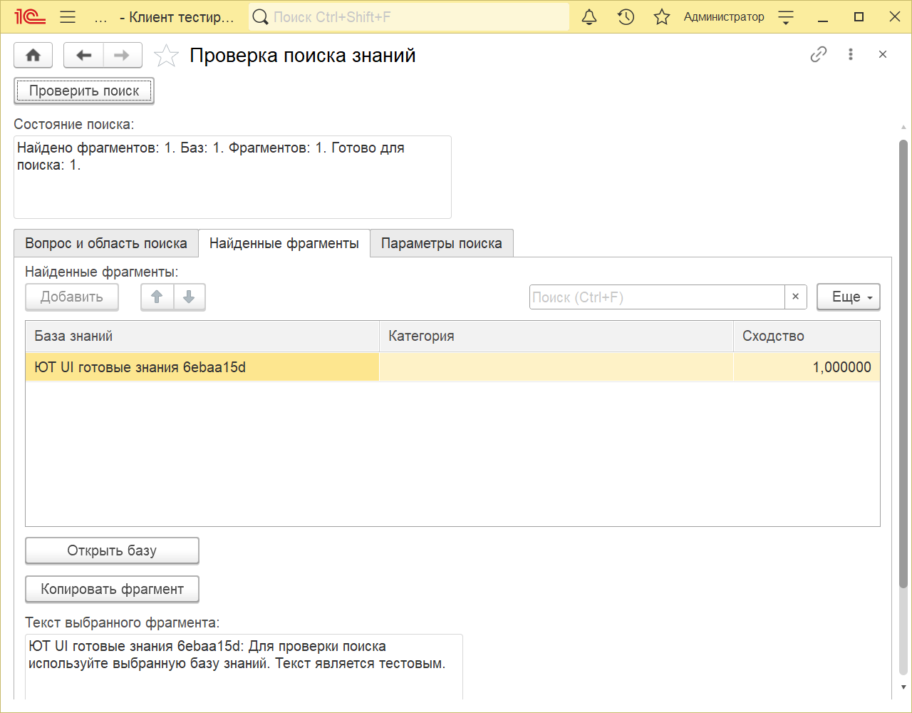
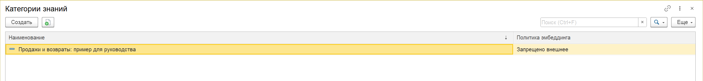
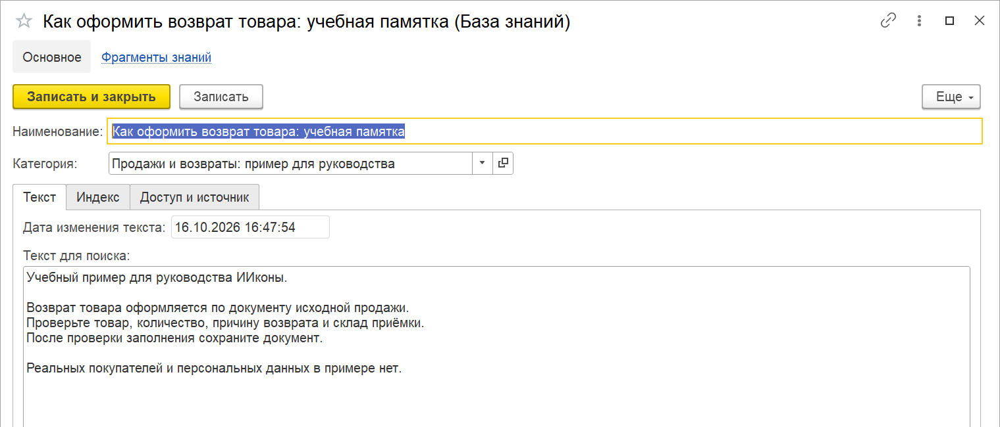
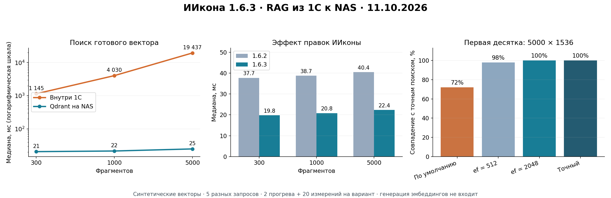

# RAG

RAG (retrieval-augmented generation) в ИИконе — это **семантический поиск по базе знаний**:
модель получает не всю базу, а несколько самых релевантных запросу фрагментов, подмешанных
в промпт. Поиск идёт по смыслу (векторная близость), а не по словам.


## Доступ к знаниям и проверка поиска

Откройте «ИИкона» → «Знания»: здесь база знаний, категории и фрагменты.
В списке и карточке базы показаны состояние индекса, число фрагментов и готовых
векторов, модель индекса, даты текста и индекса. Сохраненный текст и его индекс
могут иметь разные даты: после изменения текста требуется индексация.

Из выбранной карточки запускаются операции именно для этой базы. Перед индексацией
запишите изменения. Команды изменения индекса доступны администратору ИИконы;
просмотр и проверка готовности доступны базовой роли.

«Проверка поиска» открывается из карточки базы, ее списка и карточки эксперта.
Введите вопрос, при необходимости уточните категорию, эксперта, количество результатов
и порог сходства. Из карточки базы поиск ограничен выбранной базой. Выбранная модель
проверки действует только в этой операции и не заменяет общую модель индекса.

Готовность оценивается без обращения к чат-модели. При выполнении поиска вопрос
передается настроенному эмбеддеру после подтверждения; отказ ничего не отправляет.
Форма различает отсутствие подходящих источников, неготовый индекс, ошибку API
и неверную размерность. На странице «Найденные фрагменты» видны источник, категория,
сходство и полный текст. «Открыть базу» открывает источник, «Копировать фрагмент»
копирует текст. Генерация ответа чат-моделью здесь не выполняется.



Пример снят на собственных проверочных данных с локальным эмбеддером.

## Как это устроено

```
Документ БЗ ─▶ нарезка на фрагменты ─▶ эмбеддинг (вектор) ─▶ хранится в 1С
Запрос ─▶ эмбеддинг ─▶ поиск ближайших векторов ─▶ топ-N фрагментов ─▶ в промпт
```

Каждый фрагмент базы знаний превращается в **вектор** (эмбеддинг) через модель-эмбеддер.
Векторы хранятся прямо в 1С. При запросе ИИкона эмбеддит сам запрос и находит фрагменты с
наибольшей косинусной близостью — это и есть релевантный контекст для модели.

## Что нужно

- **Модель-эмбеддер** — элемент справочника «Модели ИИ» с `Тип модели = Эмбеддинг`
  (см. **[Настройка моделей](../настройка-моделей/README.md)**). Транспорт тот же, что у
  чат-моделей — тот же адрес, авторизация, прокси.
- **База знаний** — документы с содержимым, разбитые по категориям.

## Модель сохранённого индекса

В проверке выбранной базы знаний модель поиска подставляется по сохранённому индексу,
а поле модели становится доступным только для просмотра. Вопрос нужно преобразовать
той же моделью, которой построены векторы фрагментов: одинаковой размерности недостаточно.

Если индекс старый и его код подходит нескольким подключениям к одной модели, администратор
один раз выбирает нужное подключение и сохраняет привязку. Ключ при этом не показывается.
Если подключение не найдено или индекс построен другой моделью, форма сообщает причину;
не выбирайте произвольную модель для обхода сообщения. Настройте подходящее подключение
либо осознанно перестройте индекс нужной моделью.

Для проверки поиска по базе эксперт необязателен. Эксперт нужен для его промпта и категорий
при работе через чат. Форма «Проверка поиска» показывает фрагменты и источники; чат-ответ
эксперта в этой форме не генерируется.

## Настройка по шагам

1. **Эмбеддер.** Создайте модель с `Тип модели = Эмбеддинг`: провайдер, полное имя модели
   (например, `text-embedding-3-small`), эндпоинт эмбеддингов, размерность вектора
   (для OpenAI — 1536), класс egress (см. «Приватность»).
2. **Категории и политики.** Заведите категории знаний и задайте каждой политику egress —
   можно ли отправлять её тексты во внешний API.
3. **База знаний.** Создайте документы базы знаний (категория + содержимое), затем запустите
   переиндексацию — ИИкона нарежет содержимое на фрагменты. Повторная переиндексация
   без изменения текста ничего не пересоздаёт.
4. **Эмбеддинги.** Запустите обновление эмбеддингов (вручную или регламентным заданием) —
   ИИкона пройдёт по фрагментам, проверит политику egress, получит и сохранит векторы.
5. **Эксперт.** В карточке эксперта в таблице «Категории знаний (RAG)» выберите категории
   (с 1.6.1). «Чат с экспертом» будет искать по вопросу три ближайших фрагмента в этих категориях и
   подмешивать их в промпт эксперта — подробнее на странице
   [Эксперты ИИ](../эксперты/README.md#база-знаний-в-ответах).



*Исторический снимок до 1.6.2; расположение элементов и подписи в текущей версии изменены.*



*Исторический снимок до 1.6.2; расположение элементов и подписи в текущей версии изменены.*

## Приватность (egress-политики)

RAG задумывался так, чтобы **не отправлять чувствительные данные во внешние API**. У каждой
категории знаний — политика:

- **Запрещено внешнее** — тексты категории не отправляются наружу; фрагмент не индексируется.
  Если он был проиндексирован, а политику ужесточили — эмбеддинг очищается, и фрагмент
  уходит из поиска.
- **Только РФ** — индексировать разрешено только эмбеддером с классом egress «Только РФ»
  (российский провайдер).
- **Разрешено внешнее** — любой провайдер.

Документ базы может переопределить политику своей категории. Проверка egress выполняется
**перед** отправкой текста — запрещённое не покидает контур.

С версии 1.5.0 текст, который уходит эмбеддеру, — вопрос пользователя и фрагменты при
индексации — проходит ещё и **[контроль персональных данных](../контроль-персональных-данных/README.md)**:
ФИО, ИНН, телефоны заменяются подстановками. Цена: через внешний эмбеддер фрагмент не находится
по конкретному ФИО или номеру. Для такого поиска используйте локальный эмбеддер и отметьте его
маршрут доверенным в карточке модели. Если режим модели-эмбеддера «Не отправлять», фрагменты
с персональными данными не индексируются — в журнале регистрации остаётся предупреждение.

## Два бэкенда поиска: внутренний и внешний

ИИкона умеет искать двумя способами; переключается настройкой, контракт поиска для
подсистем не меняется.

| | **Внутренний (нативный)** | **Внешний (Qdrant)** |
|---|---|---|
| Где считается близость | прямо в 1С (линейный перебор) | во внешнем векторном сервисе Qdrant |
| Хранилище векторов | 1С | 1С (источник истины) + Qdrant (производный индекс) |
| Инфраструктура | ничего дополнительно | нужен развёрнутый Qdrant |
| Для каких объёмов | небольшие базы (сотни фрагментов) | большие базы |

**Внутренний** поиск не требует ничего, кроме 1С, и подходит для небольших баз знаний —
время растёт с числом фрагментов и размерностью векторов. Линейный перебор растёт с
числом фрагментов, поэтому для крупных баз предусмотрен внешний бэкенд.

**Внешний** (Qdrant) выносит поиск в специализированный векторный сервис — векторы по-прежнему
хранятся в 1С как источник истины, а Qdrant синхронизируется с ними и держит производный
индекс. Включается константой выбора бэкенда; переключение не ломает уже настроенный поиск.

### Повторные замеры 11.10.2026

Оба пути проверены из 1С: внутренний поиск с чтением данных из базы и Qdrant на NAS
с сетью, разбором ответа и чтением найденных текстов из 1С. Векторы синтетические,
размерность 1536: пять запросов, два прогрева и 20 измерений для каждого размера.

| Фрагменты | Внутри 1С: медиана | Qdrant по умолчанию: медиана |
|---|---|---|
| 300 | 1,15 с | 20,6 мс |
| 1000 | 4,03 с | 21,6 мс |
| 5000 | 19,44 с | 24,9 мс |

На 5000 случайных векторах приближённый поиск по умолчанию совпал с точным в среднем
на 72% первой десятки. Точный режим Qdrant дал полное совпадение на пяти проверенных
запросах при медиане 24,6 мс. Точные параметры задавались только проверочным сценарием;
настройка продукта этим замером не менялась. Эти числа не оценивают смысловое качество
ответов на реальные вопросы.

В отдельном сравнении одного индекса версия 1.6.3 сократила медиану пути Qdrant с 40,4
до 22,4 мс благодаря чтению найденных фрагментов одной порцией без распаковки их векторов.
Получение эмбеддинга моделью не входит в измерения; его код по сравнению с 1.6.2 не менялся.
На малых наборах внешняя модель может занимать основную часть ожидания.



Полные условия, p95, исходные измерения, сравнение версий и предварительный опыт
пакетной/параллельной отправки — [в отчёте](measurements-2026-10-11.md).
Старые 17 с / 9 мс измерялись с разными границами и не используются как актуальное
сравнение. Единого порога «300 фрагментов быстрее секунды» нет: он зависит от стенда,
размерности и состава запроса. Веб-клиент, SQL и одновременная нагрузка здесь не проверялись.

## Условные обозначения

Плейсхолдеры — `<адрес-qdrant>`, `<ключ>` — подставьте свои значения.
