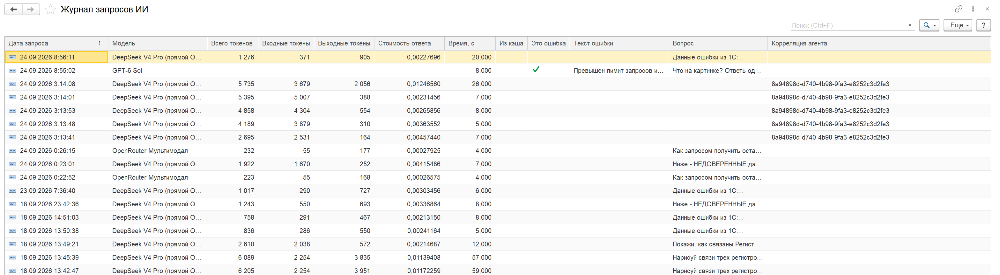
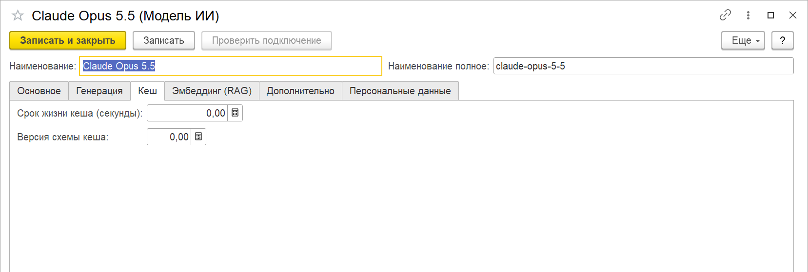
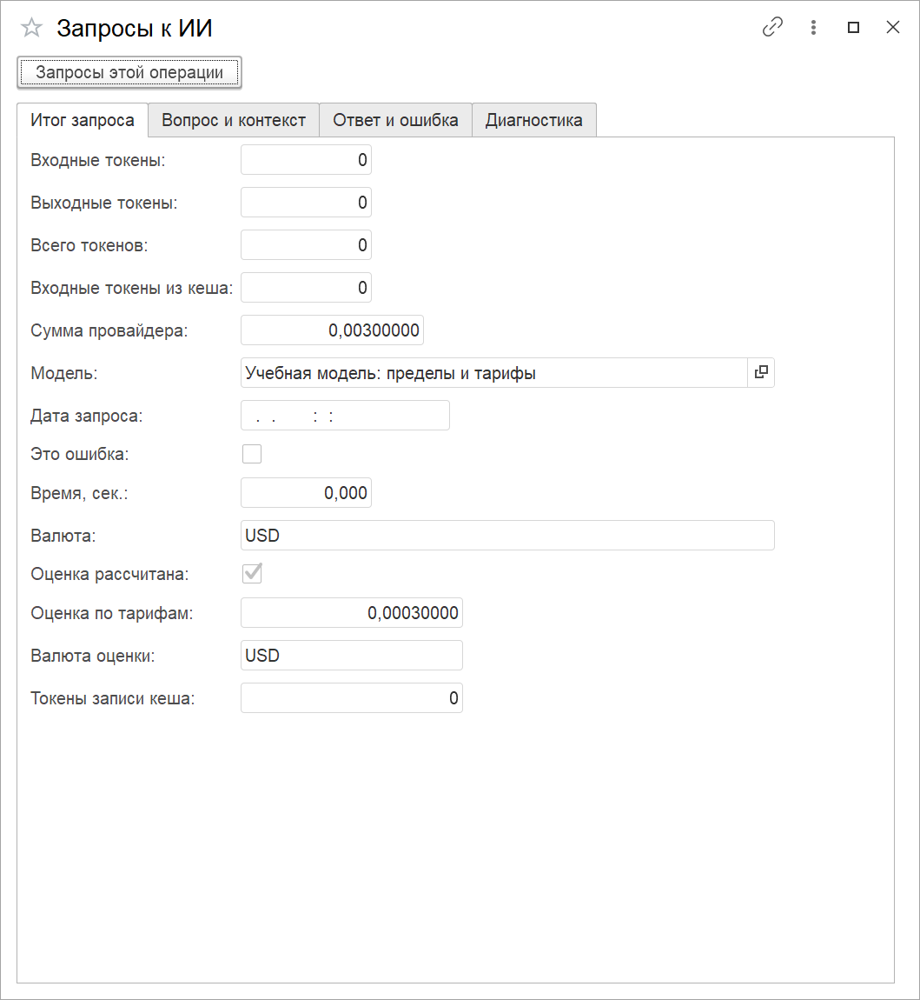

# Журнал запросов, расходы и кеш

Отправленные чат-запросы и ошибки транспорта ИИкона записывает в «Журнал запросов ИИ»:
сколько токенов ушло, сколько это стоило, сколько ждали ответа и была ли ошибка. Там же
видно, какие ответы взяты из кеша. Пустая модель и отказ контроля персональных данных
завершают вызов раньше записи в этот журнал. Для отказа контроля есть отдельный
[журнал контроля ПД](../контроль-персональных-данных/README.md).

Журнал: «ИИкона» → «Журнал запросов ИИ».

## Журнал в 1.6.2

Откройте «ИИкона» → «Мониторинг» → «Журнал запросов ИИ». Связанные запросы
открываются из разбора ошибки по идентификатору операции. Стоимость сопровождается
обозначением валюты, когда оно известно: суммы разных валют нельзя складывать как одну.

## Что в журнале

| Колонка | Что значит |
|---|---|
| Дата запроса | когда запрос ушел |
| Модель | элемент «Модели ИИ», через который шел запрос |
| Всего / Входные / Выходные токены | по данным провайдера |
| Стоимость ответа | по данным провайдера, см. «Расходы» |
| Время, с | сколько ждали ответа |
| Из кеша | ответ взят из кеша ИИконы, провайдеру запрос не уходил |
| Это ошибка, Текст ошибки | провайдер вернул ошибку или запрос не дошел |
| Вопрос | текст вопроса; для вопроса с вложениями — текст и пометки о файлах |
| Корреляция агента | общий идентификатор раундов одной [агентской петли](../агентская-петля/README.md) |

Список открывается сначала свежими записями. Отбор по модели, периоду или ошибкам — через
«Еще» → «Настроить список». Двойной щелчок открывает запись целиком: на вкладке «Вопрос и контекст» —
системный промпт, вопрос и история диалога, на вкладке «Ответ и ошибка» — ответ модели и текст
ошибки.

В журнал попадают запросы «Чата с экспертом», генератора диаграмм, анализа ошибок и все раунды
агентской петли. Запросы к модели-эмбеддеру для [RAG](../rag/README.md) не записываются.

Промпты и ответы хранятся в том виде, в каком ушли модели: если
[контроль персональных данных](../контроль-персональных-данных/README.md) заменил ФИО или ИНН,
в журнале останутся подстановки.

## Инструменты и полное тело запроса

Вкладка «Вопрос и контекст» содержит отдельные поля вопроса, инструкции и истории.
С версии 1.7.4 у инструментального запроса в поле JSON сохраняются `messages`
и `tools` после контроля персональных данных. Здесь можно проверить диалог,
описания функций и параметры, предложенные модели. Это внутреннее содержимое
запроса: HTTP-заголовки и ключ авторизации в него не входят; формат тела
конкретного провайдера может отличаться.

У обычного запроса без агентской петли в этом поле хранится история сообщений;
отсутствие `tools` само по себе не означает ошибку. Используйте идентификатор операции
для просмотра связанных записей с показателями раундов. Факты вызовов инструментов
фиксируются также в журнале регистрации событием `КИИ.АгентАнализа.Вызов`.
Подробности — на странице [агентская петля](../агентская-петля/README.md#что-остается-в-базе).

## Расходы

Стоимость в журнал записывается, только если провайдер сам возвращает ее в ответе. Так
делает OpenRouter, когда в ответе есть поле `usage.cost`; значение учитывается в долларах. OpenAI, Anthropic,
Google, GigaChat и YandexGPT стоимость не возвращают — у их запросов в колонке пусто, а
расходы видны в личном кабинете провайдера.

Сумма токенов и стоимости по дням есть на [дашборде ошибок](../анализ-ошибок/README.md);
ответы из кеша в эту сумму не входят.

### Оценка по собственным тарифам: 1.8.1

Начиная с 1.8.1 в карточке модели можно включить **«Оценивать стоимость»**, указать валюту и четыре цены за миллион токенов: вход, выход,
чтение кеша провайдера и запись в него. Это отдельная оценка, она не заменяет
сумму, возвращённую провайдером, и не подтверждает списание денег.

Расчёт использует статистику ответа. Обычный вход равен входным токенам за
вычетом чтения и записи кеша; каждую часть умножаем на её тариф, затем делим
общую сумму на миллион. При отсутствии нужной статистики или её некорректности
оценка остаётся недоступной. Бесплатное чтение локального кеша ИИконы имеет
нулевую оценку нового обращения.

В журнале отдельно сохраняются признак расчёта, сумма, валюта и JSON тарифов
на момент запроса. Последующее изменение модели не пересчитывает прежнюю запись.
В петле итог суммируется по раундам, когда оценка доступна для каждого из них
и валюта совпадает. Конвертации валют нет.

Настройка находится в карточке модели на вкладке «Кеш и тарифы».
На дашборде прежний показатель расходов по данным провайдера не заменяется этой оценкой.

## Оценка под ответом чата: 1.8.3

Под ответом в чате показывается «Оценка по тарифам за весь ответ» с валютой.
Для агентской петли это сумма всех обращений к модели, включая финальный запрос,
а не стоимость последней строки журнала. В расчёт входят только обращения
этого ответа; предыдущие ответы диалога повторно не прибавляются.

Если хотя бы для одного раунда нет пригодной оценки или валюты различаются,
вместо суммы выводится «Оценка по тарифам: не рассчитана». Известный нулевой
расчёт показывается числом. Для обычного ответа без инструментов используется
оценка одного обращения. Это оценка по введённым тарифам, а не подтверждение
списания у провайдера; стоимость внешнего HTTP-сервиса в неё не входит.

## Кеш ответов

Кеш возвращает сохраненный ответ на точно такой же запрос без обращения к провайдеру — быстро
и бесплатно. Полезен там, где один и тот же вопрос задается многократно.

По умолчанию кеш выключен. Включается в карточке модели на вкладке «Кеш»:

1. **Срок жизни кеша (секунды)** — сколько хранить ответ, например `86400` — сутки.
2. **Версия схемы кеша** — поставьте положительное число, например `1`.
   Значение `0` отключает локальный кеш; это не автоматический выбор версии.
   Для включения нужны одновременно положительный срок жизни и положительная версия схемы.
3. На вкладке «Генерация» — **Температура** `0`. Это условие включения кеша в ИИконе.
   Нулевое значение сейчас не включается в HTTP-тело запроса, как в 1.6.2; сервис использует
   своё значение по умолчанию. Поэтому эта настройка не гарантирует детерминированный
   ответ модели. Включайте кеш только там, где допустимо повторно показывать сохранённый ответ.

«Точно такой же запрос» — совпадают модель, системный промпт, вопрос, вложения, история
диалога, температура и максимум токенов. Хватит одного лишнего пробела, чтобы запрос ушел
провайдеру.

Кеш не используется:

- для генерации картинок;
- для раундов агентской петли;
- при программном вызове `ЗапросКМодели(Модель, Промпт, , Ложь)`;
- если контроль персональных данных сделал в запросе замены — подстановки меняются от запроса
  к запросу.

Чтобы разом сбросить сохраненные ответы модели, увеличьте «Версию схемы кеша» на единицу:
старые записи перестанут подходить.

## Кеш ИИконы и кеш провайдера

Это два независимых механизма. Признак «Из кеша» означает получение готового
ответа из локального кеша ИИконы без нового обращения к модели. Поля входных
токенов чтения или записи кеша относятся к статистике провайдера: запрос к нему
при этом был, а порядок кеширования и цену определяет его сервис.

Наличие входных токенов из кеша провайдера не подтверждает включение локального
кеша ИИконы. Нулевое значение суммы провайдера также не подтверждает бесплатность:
сервис мог не передать стоимость. Для расчётной оценки используйте тарифы модели,
для фактических списаний — сведения своего провайдера.

## Сколько хранится

| Что | Кто чистит |
|---|---|
| Кеш ответов | регламентное задание «Очистка кеша ответов ИИ» удаляет записи с истекшим сроком, каждую ночь в 03:00 |
| Журнал запросов ИИ | регламентное задание очистки мониторинга ошибок, по сроку «Хранить ошибки, дней» из [настроек мониторинга](../анализ-ошибок/README.md); задание появляется после «Включить регламенты» на дашборде ошибок |

Без включенных регламентов мониторинга журнал запросов не чистится.

С версии 1.6.1 задание очистки кеша создается само — при записи модели ИИ, заполнении
предустановленных моделей или сохранении настроек ИИконы. До 1.6.1 его не создавал никто:
после обновления откройте и запишите любую модель, чтобы оно появилось.

## Пример раздельных сумм

Цветной снимок 1.8.1 от 20.10.2026. Запись создана для показа полей, суммы введены
как учебные значения; оплаченного запроса за этим примером нет. Поле «Оценка рассчитана»
отличает недоступный расчёт от настоящего нуля. Сумму провайдера и оценку не следует складывать.
