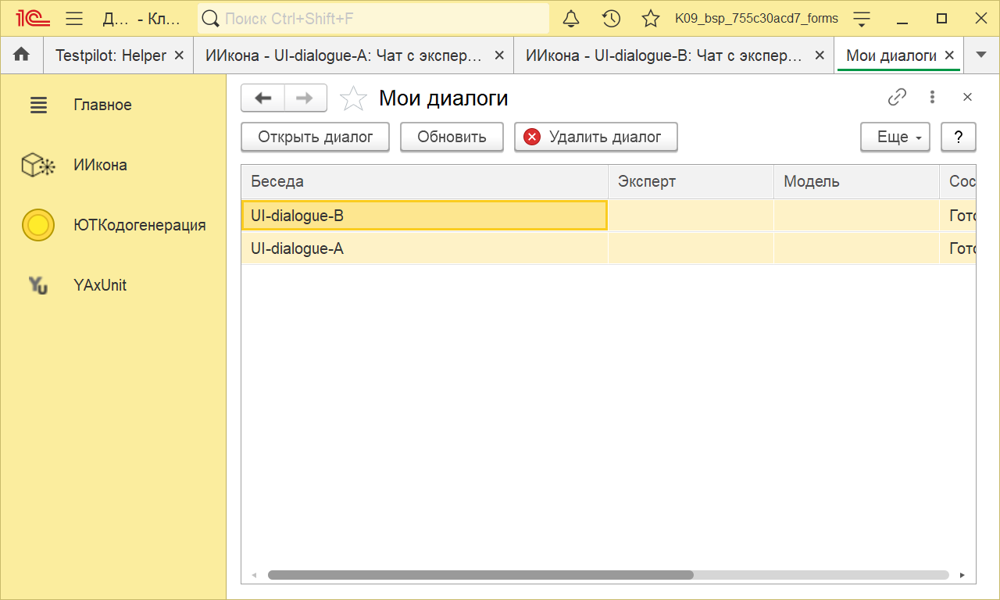
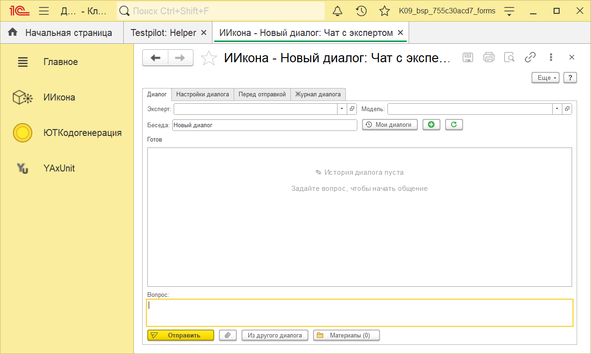

# Беседы, контекст и журнал чата

В ИИконе 1.9.3 чат сохраняет отдельные беседы в базе. У каждой беседы свои
история, черновик вопроса, эксперт, модель, материалы и настройки состава запроса.
Откройте «ИИкона» → «Чат с экспертом».

## Несколько бесед

Создайте беседу командой «Новый диалог». Каждая беседа открывается отдельной
формой на штатной вкладке 1С. У каждой формы своё поле вопроса и свой черновик.
Ответ, полученный в фоне, сохраняется в той беседе, из которой был отправлен запрос.
Можно перейти в другую вкладку и продолжить работу, пока первая ожидает ответ.

Закрытие вкладки сохраняет беседу. Откройте «Мои диалоги», выберите нужную запись
и вернитесь к истории и черновику. Название можно изменить; переносы строк
в заголовках не раздвигают вкладки. Новый вопрос сохраняет исходные переносы.

Беседы и материалы разделены по пользователям. Право просмотра общего журнала
запросов не дает доступа к чужим сохраненным беседам.

## Состояние материалов

В 1.9.3 таблица материалов показывает направление файла и состояние связанного запроса. Для черновика виден выбор отправки, для отправленного вопроса — принятие, выполнение, неизвестный результат, ошибка или завершение. Изменившийся статус обновляется при прежнем числе сообщений.

Команда «В следующий вопрос» создаёт отдельную исходящую копию выбранного файла. Предыдущая отправка сохраняет состояние своего запроса. При сбое сохраните код обращения и соберите диагностику 1.0.2 за время выполнения. Полные тексты отказавших запросов и параметры прикладываются отдельно после проверки на конфиденциальные данные.

## Выход из приложения

Версия 1.9.2 исправляет ошибку завершения работы при открытом чате. Обычное закрытие вкладки сохраняет черновик. При выходе из всей программы обработчик закрытия заканчивает работу до серверных вызовов. Вернуться к сохранённой беседе можно через «Мои диалоги».

[Последовательная проверка интерфейса](проверка-интерфейса.md).

## Удалить беседы

Откройте «Мои диалоги», выделите одну или несколько строк и нажмите
«Удалить диалог». Команда снабжена подсказкой. Для нескольких строк появится
одно подтверждение с их количеством; по умолчанию выбран ответ «Нет».

После удаления список обновляется сразу, вкладки удалённых бесед закрываются.
История, черновики и вложения этих бесед удаляются без возможности восстановления;
технический журнал запросов сохраняется.

Беседа с незавершённым запросом или материалами, используемыми другой беседой,
защищена. Если хотя бы одна выбранная запись недоступна или изменилась после
подтверждения, весь набор сохраняется. При отказе прочитайте причину в штатном
сообщении 1С; техническая диагностика сохраняется штатным механизмом платформы. Если источник и использующая его
беседа выделены вместе, сначала удалите использующую беседу отдельной операцией.

## Вопрос и вложения

Выберите эксперта и модель в активной беседе, введите вопрос. Для отправки
нажмите кнопку или **Ctrl+Enter**; Enter оставляет перенос в тексте вопроса.
История прокручивается внутри своей области. Для небольшого окна можно
уменьшить масштаб формы средствами 1С.

Файлы прикрепляются кнопкой около вопроса. Состав выбранных материалов
доступен на странице «Материалы». Здесь можно исключить материал из следующей
отправки, сохранив его в беседе.

Можно явно выбрать сообщение или файл из другой своей беседы. Модель получает
выбранный материал, а не доступ ко всем соседним вкладкам. Цитаты и ссылки
на сохраненные версии файлов показываются в составе материалов.

Каждый запрос к модели собирается в 1С из выбранного контекста. Подписка
сама по себе не означает, что провайдер хранит за приложением постоянную беседу.
При включенной истории текстовые вложения прошлых сообщений восстанавливаются
в отправляемом контексте. Для прежнего двоичного файла история содержит имя
и пояснение, что его содержимое не передано повторно. Если содержимое нужно
в новом запросе, приложите файл к нему явно. Инструменты самостоятельного
чтения файлов из хранилища бесед в этом выпуске не заявлены.

## Настроить состав запроса

На странице «Настройки диалога» задайте состав следующего запроса:

| Настройка | Действие |
| --- | --- |
| История диалога | Добавляет предыдущие вопросы и ответы выбранной беседы. |
| Последних сообщений в контексте | Ограничивает передаваемую историю; 0 означает всю доступную историю с учетом общего бюджета. |
| Знания эксперта | Разрешает подбор справки из категорий, назначенных эксперту. |
| Отмеченные вложения | Разрешает передачу выбранных материалов. |
| Базы для инструментов | Определяет, к каким источникам можно обращаться в этой беседе. |

Настройки сохраняются отдельно для беседы. Если у эксперта не назначены
категории знаний, подбор не найдет справку по его категориям; выберите их
в карточке эксперта. Набор инструментов дополнительно ограничивается
[настройками модели](../настройка-моделей/README.md#инструменты-модели).

## Проверить перед отправкой

1. Выберите эксперта и введите следующий вопрос на странице диалога.
2. Отметьте материалы и базы, включите нужную историю и знания.
3. Откройте «Перед отправкой» и нажмите «Обновить просмотр».
4. Проверьте получателя, инструкцию, вопрос, историю, инструменты и вложения.
   Текст показан после обработки персональных данных.
5. Если нужно изменить состав, вернитесь к исходным полям и обновите просмотр.

Это представление подготовленного запроса для чтения. Оно не предназначено
для ручного ввода отдельной инструкции или вопроса. Пустой вопрос не запускает
подготовку; после изменения исходных данных прежний просмотр помечается устаревшим.

Обычное обновление просмотра не обращается к чат-модели. «Подобрать знания»
выполняет поиск через модель эмбеддингов; выбранный эксперт передается в подбор.
При обычной отправке знания подбираются автоматически согласно настройкам.

Двоичные части в просмотре описываются текстом; такое описание не является
полным содержимым файла. Способы передачи зависят от формата API и модели:
[вложения и картинки](../вложения/README.md).

## Журнал текущей беседы

На странице журнала показываются запросы выбранной беседы и связанные раунды:
время, модель, состояние, инструменты, длительность, токены и стоимость,
если провайдер ее сообщил или настроен расчет. Сохраненный контекст доступен
для чтения. Указывать и переносить служебный идентификатор диалога вручную не нужно.

Общий журнал остается отдельным механизмом со своими правами. Записи старых
версий не превращаются в сохраненные беседы по совпадению текста или времени.

При ошибке сохраняйте код обращения и сверяйте контекст соответствующего раунда.
Если структура объекта получена не полностью, ИИкона предлагает модели продолжить
чтение в пределах настроенных бюджетов. Когда продолжение не выполнено,
пользователь видит предупреждение о неполной структуре независимо от текста модели.

[Пределы и работа инструментов](../агентская-петля/README.md) ·
[Проверки и совместимость](../совместимость/README.md).

