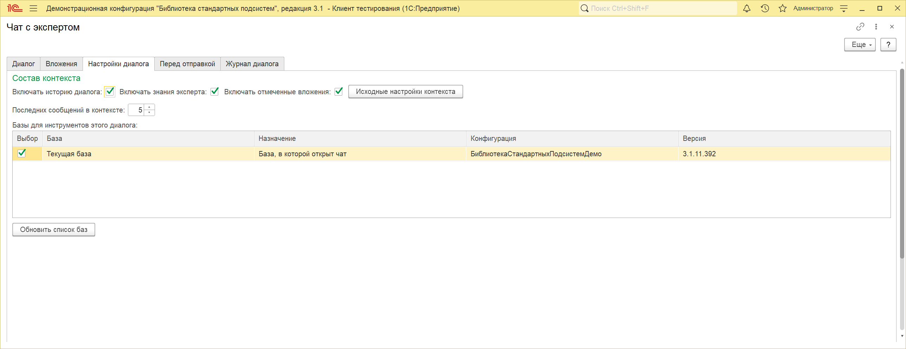
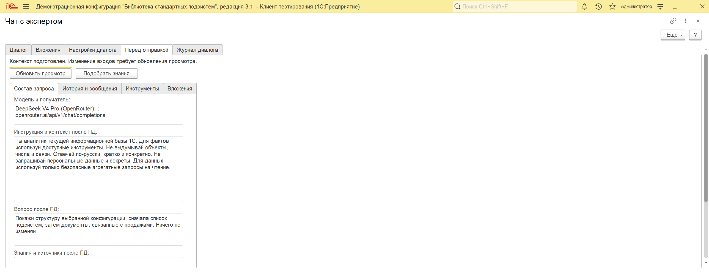
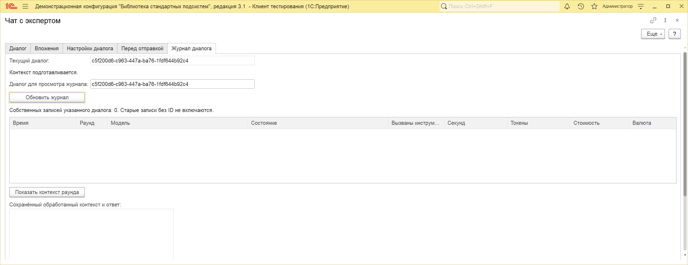

# Контекст и журнал чата

Настройки контекста, просмотр отправки и журнал диалога доступны с версии **1.8.0**. Функциональные сценарии и снимки ниже первоначально проверены на продукте **1.8.0-dev-20** с тестами **1.8.0-dev-21**. Проверки окончательного среза перечислены на странице [совместимости](../совместимость/README.md).

Откройте «ИИкона» → «Чат с экспертом». Кроме диалога и вложений, в форме доступны «Настройки диалога», «Перед отправкой» и «Журнал диалога».

## Настроить состав запроса

На вкладке «Настройки диалога» задайте, что включать в следующий запрос:

| Настройка | Что меняется |
| --- | --- |
| Включать историю диалога | В запрос добавляются предыдущие вопросы и ответы этого открытого диалога. При снятом флажке остаётся текущий вопрос. |
| Последних сообщений в контексте | Сколько предыдущих сообщений включать. По умолчанию 5; 0 означает всю доступную историю. Ошибочные сообщения не добавляются. |
| Включать знания эксперта | Разрешает подбор справки из категорий, назначенных эксперту. Пустой список категорий означает работу без базы знаний. |
| Включать отмеченные вложения | Разрешает передачу вложений с установленной отметкой отправки. Снятие флажка сохраняет файлы в форме, исключая их из запроса. |
| Исходные настройки контекста | Включает три флажка и возвращает размер истории 5. |

Настройки запоминаются для текущего пользователя. Эксперт, его модель, флажок «Использовать инструменты» и выбранные базы задаются отдельно. Список доступных инструментов можно сузить в [карточке модели](../настройка-моделей/README.md#инструменты-модели).

## Проверить перед отправкой

1. Выберите эксперта, введите вопрос, отметьте нужные вложения и источники.
2. Перейдите на «Перед отправкой» и нажмите **«Обновить просмотр»**.
3. Проверьте модель и адрес получателя, вопрос, инструкцию со справкой, историю, предлагаемые инструменты и описание вложений. Тексты показаны после обработки персональных данных.
4. Исправьте исходный вопрос или настройки, если видите лишние сведения. После изменения состава нажмите «Обновить просмотр» повторно.
5. Отправьте запрос с вкладки «Диалог».

Поля просмотра предназначены для чтения. Править вопрос нужно в диалоге; исключать историю, знания и вложения нужно соответствующими настройками.

**Простое обновление просмотра не вызывает чат-модель, модель эмбеддингов или инструменты.** Серверный контроль персональных данных продолжает работать по настройке модели. Это предварительная проверка содержимого, а не замена правил обработки ПД.

Если у эксперта назначены категории знаний и их использование включено, просмотр сначала явно обозначен как неполный. Нажмите **«Подобрать знания»**. Эта команда выполняет поиск с обращением к настроенной модели эмбеддингов; у внешнего провайдера такое обращение может учитываться отдельно от чата. После подбора видны включённая справка и ссылки на её фрагменты. Фрагменты, не поместившиеся в контекст, не перечисляются как отправленные источники.

При обычной отправке без предварительного подбора знания подбираются автоматически. Если поиск не выполнился, в просмотре появляется диагностика; сохраняется обычное поведение отправки без справки.

Двоичный файл не изображается как полный текст его содержимого. В просмотре отражаются его описание и способ передачи. Для проверки самого файла используйте его просмотр и правила страницы [«Вложения и картинки»](../вложения/README.md).

Изменение вопроса, эксперта, истории, выбранных баз, вложений или настроек делает прежний просмотр неактуальным. Если после подготовки изменились маршрут или правила доступа, отправка потребует обновления просмотра. Подготовленный запрос связан с текущими пользователем, формой и диалогом.

После отправки вкладка показывает **снимок отправленного запроса**. Для следующего вопроса сформируйте новый просмотр. Результаты инструментов последующих раундов появляются по ходу выполнения; заранее они неизвестны. Сохранённый обработанный контекст этих раундов доступен в журнале.

## Посмотреть журнал диалога

На вкладке «Журнал диалога» нажмите **«Обновить журнал»**. Таблица показывает связанные запросы и раунды: время, модель, состояние, вызванные инструменты, длительность, токены и стоимость при наличии.

Выберите строку и нажмите **«Показать контекст раунда»**. Ниже появятся сохранённые вопрос и инструкция после обработки ПД, сообщения с инструментами, ответ или ошибка. Для незавершённой операции завершённой записи ещё может не быть.

Журнал отбирается одновременно по идентификатору диалога, текущему пользователю и действующим правам чтения. Даже административные права не превращают эту вкладку в общий журнал всех пользователей. Дополнительная передача выдержки модели для её просмотра не выполняется.

Команда **«Новый диалог»** после подтверждения убирает вопрос, историю и вложения из формы и создаёт другой идентификатор. Прежние записи журнала сохраняются. Чтобы вернуться к ним, заранее скопируйте поле **«Текущий диалог»**, затем вставьте этот идентификатор в **«Диалог для просмотра журнала»** и обновите таблицу.

При закрытии и повторном открытии формы начинается другой диалог. История переписки между такими открытиями отдельно не восстанавливается. Старые записи журнала, созданные до появления идентификаторов диалога, не привязываются к нему по похожему тексту или времени.

Ключ авторизации и HTTP-заголовки модели в эти представления не добавляются. Содержание вопроса, инструкции и ответа остаётся данными журнала и подчиняется обычным настройкам его хранения.

Новый диалог до отправки запроса модели имеет пустой журнал:

## Границы проверки

Для этого блока прошли 205 выбранных YAxUnit, включая 7 клиентских, и 35 различных проверок настоящего управляемого чата. Проверены положительный подбор знаний через локальную HTTP-оснастку, источники, маскирование, инструментальные раунды, ошибки, собственник диалога и длинные тексты формы. Учебные ответы оснастки подтверждают состав запросов; качество ответов внешней модели ими не оценивается.

Цветные снимки вкладок сделаны 17 октября на том же установленном продукте 1.8.0-dev-20. На снимке предпросмотра подготовлен пример вопроса о структуре конфигурации; запрос чат-модели не отправлялся. Журнал показан для нового диалога без отправленных запросов. Цветные примеры [настоящих диалогов](../эксперты/README.md#реальные-примеры-из-чата) относятся к подписанным на них версиям.
