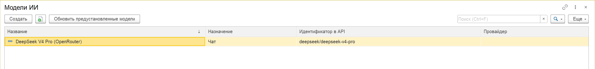
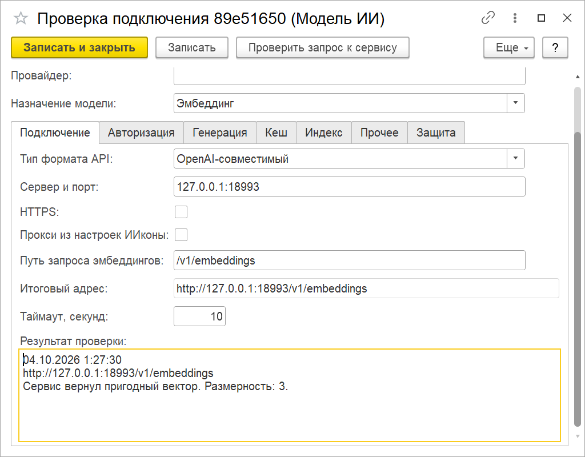
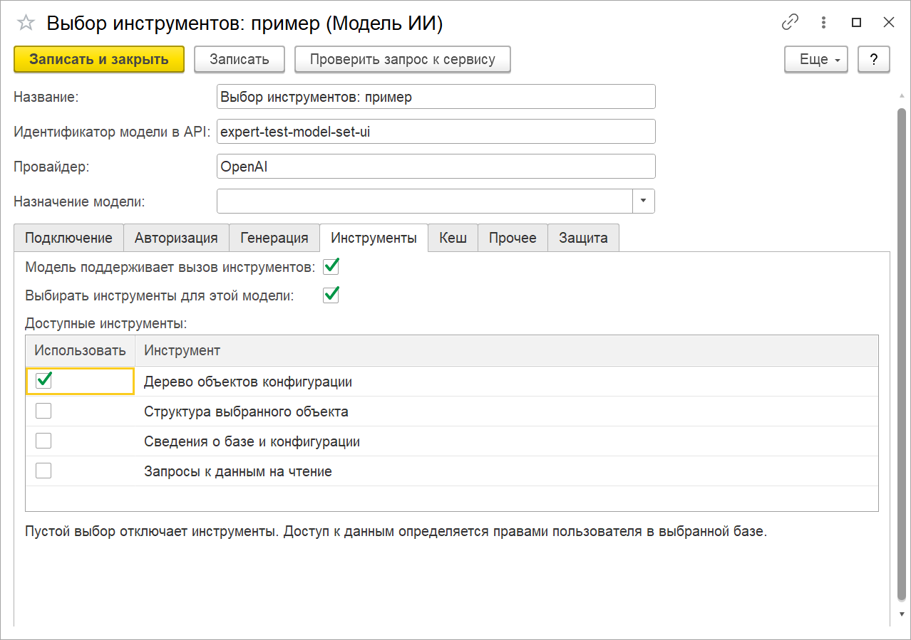

# Настройка моделей

Все обращения к языковым моделям в ИИконе идут через единый **коннектор** (`КИИ_КоннекторИИ`).
Модель — это элемент справочника **«Модели ИИ»**: адрес провайдера, формат API, способ
авторизации и параметры генерации. Настроил один раз — пользуются все подсистемы (чат,
аудитор кода, генератор диаграмм, RAG).

## Как это устроено

```
Подсистема ─▶ КИИ_КоннекторИИ ─▶ провайдер-адаптер ─▶ HTTP ─▶ API модели
             (прокси, таймаут,     (OpenAI / Anthropic /
              retry, auth)          Google / Yandex / GigaChat)
```

Коннектор сам подбирает адаптер под формат API модели, подставляет заголовки авторизации,
при необходимости идёт через прокси и повторяет запрос при обрыве авторизации. Подсистемам
не нужно знать, к какому провайдеру они обращаются — они просто зовут коннектор.

## Предустановленные модели

При первом запуске ИИкона предлагает заполнить справочник готовым набором из нескольких
десятков моделей популярных провайдеров: OpenAI, Anthropic, Google, Yandex, GigaChat,
DeepSeek, Mistral, Qwen, Groq, xAI, Cohere, OpenRouter, Azure OpenAI, Ollama.
Это шаблоны — адрес, формат API, тип авторизации и разумные параметры уже заполнены;
остаётся вписать свой ключ.

Набор заполняется из формы списка «Модели ИИ»: на пустом справочнике кнопка называется
«Заполнить модели». Когда модели уже есть (например, после обновления расширения), та же кнопка
называется «Обновить предустановленные модели» и сначала спрашивает подтверждение: она добавляет
новые предустановки и перезаполняет из шаблона модели с точно таким же наименованием — ключи API
при этом сохраняются. Свои модели с другими именами (например, «GPT-6 Sol (через прокси)») не
трогает, а устаревшие пресеты не удаляет — ненужные пометьте на удаление сами.



*Цветной снимок проверенного клиента 1.8.0-dev-10 от 16.10.2026. Показана существующая модель стенда; новый выпуск ещё не опубликован.*

## Ключевые поля модели



| Поле | Что задаёт |
|---|---|
| **Название** | как модель называется в списках выбора (например, «Claude Opus 5.5») |
| **Идентификатор модели в API** | идентификатор модели в API провайдера (`claude-opus-5-5`, `gpt-6-sol`, `deepseek-flash`) |
| **Сервер и порт** / **Путь запроса чата** | хост и путь эндпоинта; уходят в HTTP-запрос дословно |
| **HTTPS** | HTTPS (обычно да; выключить для локального Ollama) |
| **Тип формата API** | как формировать тело и разбирать ответ: `OpenAI_Compatible`, `Anthropic`, `Google`, `Yandex`, `GigaChat` |
| **Способ авторизации** | `Bearer`, `XApiKey`, `ApiKey`, `OAuth2ClientCredentials` |
| **Температура** | ненулевое значение передаётся провайдеру; `0` не включается в HTTP-тело, как в 1.6.2 |
| **Максимум токенов** | верхний предел длины ответа |
| **Таймаут** | сколько ждать ответа, секунд (рассуждающим моделям ставьте больше) |
| **Прокси из настроек ИИконы** | использовать прокси ИИконы; без флажка действуют настройки прокси платформы 1С |
| **Поддерживает инструменты** | модель умеет function-calling (нужно генератору диаграмм и агент-анализу) |
| **Заголовки** | дополнительные HTTP-заголовки (табличная часть; `Content-Type`, версия API и т.п.) |

## Инструменты модели

Выбор инструментов доступен с версии **1.8.0**. Снимок этой настройки получен на **1.8.0-dev-15**; версия снимка сохранена в подписи.

Откройте «ИИкона» → «Модели ИИ», выберите модель и перейдите на вкладку **«Инструменты»**.

1. Флажок **«Модель поддерживает вызов инструментов»** сообщает ИИконе о возможности вызова функций у провайдера. Он не проверяет эту возможность автоматически. В 1.7.4 этот флажок находится на вкладке «Генерация».
2. Включите **«Выбирать инструменты для этой модели»** и отметьте нужные строки. Можно разрешить только метаданные, оставив запросы к данным выключенными.
3. Нажмите «Записать». Выбор действует со следующего запроса; уже выполняющийся запрос использует прежний снимок настройки.



*Цветной снимок кандидата 1.8.0-dev-15 от 16.10.2026. Название «Выбор инструментов: пример» относится к временной проверочной модели, реальный провайдер в этом сценарии не вызывается.*

| Пункт формы | Имя инструмента | Назначение |
| --- | --- | --- |
| Дерево объектов конфигурации | `get_metadata_tree` | состав объектов выбранной базы |
| Структура выбранного объекта | `get_object_structure` | реквизиты, табличные части и их типы |
| Сведения о базе и конфигурации | `get_configuration_info` | версия, поставщик и доступные сведения о расширениях |
| Запросы к данным на чтение | `execute_query` | результат разрешённого запроса с правами пользователя источника |

**Включён отдельный выбор и сняты все отметки:** ИИкона не предлагает инструменты и не выполняет даже самостоятельно придуманный моделью вызов. Пустой выбор не заменяется набором по умолчанию.

**Отдельный выбор выключен:** сохраняется прежнее поведение. Старые модели после обновления остаются в этом режиме. Прикладной вызов петли может дополнительно сузить разрешённый набор, например запретить чтение данных в мониторинге.

Один эффективный список используется и в запросе к модели, и при исполнении её вызовов. Выбор инструмента не выдаёт доступ к базе или данным: права пользователя источника и контроль персональных данных продолжают действовать. Флажок «Использовать инструменты» в самом чате включает агентскую петлю отдельно.

## Форматы API

ИИкона переводит внутренний запрос в формат конкретного провайдера. Достаточно выбрать
правильный **Тип формата API**:

- **OpenAI_Compatible** — самый распространённый: сам OpenAI и все, кто повторяет его схему
  `/v1/chat/completions` (DeepSeek, Mistral, Qwen, Groq, xAI, Cohere, OpenRouter,
  Azure, Ollama, GigaChat). Ответ читается из поля `content`.
- **Anthropic** — Claude (эндпоинт `/v1/messages`, заголовок `anthropic-version`).
- **Google** — Gemini (эндпоинт `generateContent`, ответ из `text`).
- **Yandex** — YandexGPT (эндпоинт `/foundationModels/v1/completion`, заголовок папки).
- **GigaChat** — отдельный формат чата, вызовов функций и загрузки вложений. Для файлов
  используйте этот формат; обычная OpenAI-совместимая схема не заменяет загрузку файлов GigaChat.
- **OpenAI_ImageGen** — отдельный режим генерации изображений; настройка описана в
  разделе [вложения и картинки](../вложения/README.md#генерация-картинок).

## Ключи API

Ключ модели **не хранится в справочнике открытым текстом** — он лежит в безопасном хранилище
1С. На форме элемента модели есть поле для ввода ключа: введённое значение уходит в
хранилище, а в поле остаётся заглушка. Поле рассчитано на длинные токены (IAM-токены Яндекса,
сервисные ключи) без ограничения длины.

## Авторизация по типам

| Тип | Как работает | Кто использует |
|---|---|---|
| **Bearer** | `Authorization: Bearer <ключ>` | OpenAI, DeepSeek, Mistral, Groq, xAI, OpenRouter, YandexGPT |
| **XApiKey** | заголовок `x-api-key: <ключ>` | Anthropic (Claude) |
| **ApiKey** | ключ в заголовке/параметре провайдера | Google, Azure |
| **OAuth2ClientCredentials** | коннектор сам получает и обновляет токен по client credentials | GigaChat |

Для Yandex, помимо ключа, нужен идентификатор папки — укажите его в заголовках
модели по образцу предустановленного шаблона.

Для GigaChat в режиме `OAuth2ClientCredentials` токен получается отдельным
HTTPS-запросом к `https://ngw.devices.sberbank.ru:9443/api/v2/oauth` с областью
`scope=GIGACHAT_API_PERS`. Адрес и область получения токена зафиксированы в этой
версии; заголовки карточки модели их не меняют. Поля **«Сервер и порт»** и
**«Путь запроса чата»** относятся к запросу модели с уже полученным токеном.
Проверка подключения к корпоративному серверу с другим адресом или областью
получения токена требует отдельной поддержки такого режима.

## Прокси

Если 1С-сервер ходит в интернет через прокси, включите у модели флаг **«Использовать
прокси»** — коннектор направит запрос через прокси из настроек ИИконы. Адрес прокси задаётся
константой (адрес хоста с портом; только порт без хоста недопустим). При выключенном флаге
коннектор не задаёт собственный прокси и сохраняет поведение платформы 1С по умолчанию.
Это не принудительно прямое соединение: платформа может использовать свой настроенный прокси.
У прокси ИИконы настроен обход локальных адресов, чтобы локальные модели оставались доступны.

## Модели для эмбеддингов (RAG)

Кроме чат-моделей, справочник хранит **модели-эмбеддеры** для семантического поиска. У них
`Тип модели = Эмбеддинг` и дополнительные поля (эндпоинт эмбеддингов, размерность вектора,
класс egress). Подробнее — в разделе **[RAG](../rag/README.md)**.

## Персональные данные

На вкладке **«Защита»** карточки модели задаются режим контроля ПД для этой
модели и доверенный маршрут — для своего сервера модели, запросы к которому уходят без
проверки. Подробнее — в разделе **[Контроль персональных данных](../контроль-персональных-данных/README.md)**.

## Проверка модели

Карточка состоит из страниц «Подключение», «Авторизация», «Генерация», «Кеш»,
«Индекс», «Прочее», «Защита». Итоговый адрес составляется из HTTPS, сервера и пути
соответственно назначению модели: чат или эмбеддинг.

Перед проверкой запишите изменения. «Проверить запрос к сервису» выполняет новый запрос,
не берет ответ из кеша и выводит время, адрес и результат. Для чат-модели нужен
непустой ответ; для эмбеддинга — числовой ненулевой вектор правильной размерности.
401, 404, пустой ответ и неверный вектор показываются как ошибка, а не как успех.
Успешная проверка подтверждает этот запрос; поддержку инструментов и вложений проверяйте отдельно.

Проверка идет в фоне. Отмена ожидания возвращает управление, но не гарантирует
прерывания запроса у провайдера. Пока прежний запрос выполняется, второй не запускается.

Для проверки диалога откройте «Работа с ИИ» → «Чат с экспертом». Запросы и стоимость
попадают в [журнал запросов ИИ](../журнал-запросов/README.md).

## Условные обозначения

Плейсхолдеры в примерах — `<ключ>`, `<хост>`, `<адрес-прокси>` — подставьте свои значения.
