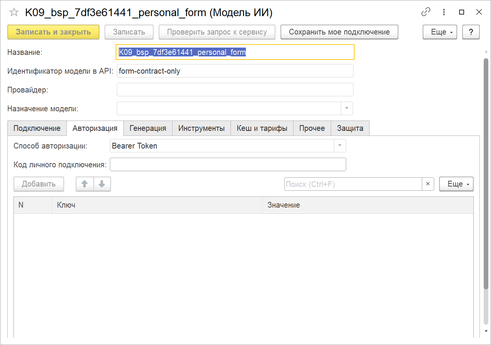

# Личное подключение ChatGPT и GLM

Инструкция к ИИконе 1.8.6. Личные подключения появились в 1.8.4; в версии 1.8.3 этого способа подключения нет. Порядок ниже описывает локальный стенд Windows: сервер 1С и
личный адаптер работают на одном компьютере.

Подписочную модель можно использовать через общий коннектор ИИконы. Чат,
предпросмотр отправки, история, контроль персональных данных и исполнение
инструментов остаются в 1С. Внешнему адаптеру передаются сообщения и описания
разрешенных инструментов; выполнять запрос к базе по собственной инициативе он
не умеет.


## Исправление передачи инструкции GLM: 1.8.5

В комплекте 1.8.5 исправлена передача системной инструкции нативному клиенту
GLM. Она передаётся как инструкция, отдельно от пользовательского сообщения;
предыдущие вопросы, ответы и инструкции разработчика сохраняются.
Обновите исходники адаптера из комплекта, сохранив каталог авторизации.
Подключать подписку заново для этого исправления не требуется.


## Какой вход используется

**ChatGPT:** официальный [Sign in with ChatGPT](https://developers.openai.com/cookbook/articles/sign-in-with-chatgpt).
В браузере пользователь разрешает приложению Iikona использовать свой план.
Адаптер обращается к публичному Responses API с отдельной авторизацией Iikona.
Файл авторизации приложения Codex для этого не используется. Доступные модели
определяются каталогом подключенного аккаунта; подписка не означает доступ ко всем
моделям OpenAI. Пользователь должен получить разрешение на использование плана,
а не только успешно войти в аккаунт.

**GLM:** личный [GLM Coding Plan](https://docs.z.ai/devpack/overview) через
[поддерживаемый клиент Codex](https://docs.z.ai/devpack/tool/others). Адаптер
использует выбранный профиль клиента в отдельном рабочем каталоге. Встроенные
инструменты, сторонние MCP и чтение файлов инструкций отключены. Выполняется один
раунд модели, вызов инструмента возвращается в 1С. Прямое обращение 1С к подписочному
Coding endpoint не входит в этот маршрут.

Подключение персональное. Один пользователь не должен раздавать свой код
сопряжения остальным пользователям базы. Доступность и допустимость использования
определяются также условиями провайдера. Для удаленного или коммерческого
размещения отдельно проверяется применимость выбранного способа подключения.

## Подготовка адаптера

Нужны Windows, Python и зависимости из `subscription-adapter/requirements.txt`.
Для GLM нужен установленный поддерживаемый клиент и уже настроенный личный
профиль GLM. Не используйте общий каталог авторизации Codex как каталог адаптера.

В примерах `C:/Iikona/subscription-adapter` обозначает каталог исходников,
а `C:/IikonaPersonal/account` является отдельным каталогом личного хранилища.
Замените пути на свои. Команды запускает владелец подключения в своем сеансе Windows.

```text
py -3.14 -m pip install -r C:/Iikona/subscription-adapter/requirements.txt
py -3.14 C:/Iikona/subscription-adapter/server.py --data C:/IikonaPersonal/account --port 18743
```

Процесс слушает только `127.0.0.1`. В первом запуске создается личный код
сопряжения. Авторизация адаптера и квитанции зашифрованы Windows DPAPI. Личные каталоги,
включая рабочие журналы поддерживаемого клиента GLM, ограничены правами текущего пользователя. Для дальнейших запусков используйте тот же каталог.
Запущенный процесс нужен во время обращения из 1С.

Для штатного закрытия консольного запуска используйте Ctrl+C. Если адаптер
запущен отдельно с параметром `--stop-file`, управляющая оснастка создает именно
указанный файл; сервер завершает работу после текущего запроса. Принудительное
завершение не является способом отмены запроса модели.

## Хранение квитанций и сырых ответов

Адаптер сохраняет квитанцию каждого запроса и зашифрованные исходные ответы.
Квитанции нужны для получения уже известного результата без повторной генерации.
Сырые ответы помогают разбирать ошибки, но со временем увеличивают рабочий каталог.

Для просмотра состава хранилища при работающем адаптере выполните:

```text
py -3.14 C:/Iikona/subscription-adapter/manage.py --data C:/IikonaPersonal/account receipts
```

По умолчанию отчёт предлагает перенести в архив сырые ответы старше 90 дней,
только если запрос завершился и его полный результат сохранён в квитанции.
Отчёт не меняет файлы. В нём есть количество, объём и хеш `plan_sha256`.
Срок можно задать параметром `--older-than-days`, например `--older-than-days 120`.

После просмотра отчёта примените именно его план:

```text
py -3.14 C:/Iikona/subscription-adapter/manage.py --data C:/IikonaPersonal/account receipts --apply-plan ХЕШ_ИЗ_ОТЧЕТА
```

Если меняли срок, укажите тот же `--older-than-days` и при применении.
При изменении состава или содержимого кандидатов адаптер откажет в применении:
сначала получите свежий отчёт. Операция ждёт завершения текущего запроса модели.

Сырые файлы переносятся в `raw-archive` внутри того же защищённого каталога.
Шифрование сохраняется. Квитанции, готовые результаты и данные продолжения
инструментов остаются на месте. Запросы с неизвестным или неполным исходом
не переносятся. Автоматического удаления файлов нет; перенос в архив сам по
себе не освобождает место на диске.

При прерывании обслуживания получите новый отчёт по оставшимся файлам.
Существующий файл архива не перезаписывается. Обслуживание не вызывает модель
и не снимает защиту от повторной оплачиваемой отправки.

## Вход ChatGPT

В другом терминале выполните:

```text
py -3.14 C:/Iikona/subscription-adapter/manage.py --data C:/IikonaPersonal/account login
```

Откройте выведенную ссылку `authorization_url` в своем браузере, войдите и
разрешите подключение Iikona. После возврата должна появиться локальная страница
подтверждения. Ссылка действует десять минут и используется однократно.

```text
py -3.14 C:/Iikona/subscription-adapter/manage.py --data C:/IikonaPersonal/account status
py -3.14 C:/Iikona/subscription-adapter/manage.py --data C:/IikonaPersonal/account models
```

Успешный вход подтверждают `connected: true` и `plan_permission: true`.
Каталог показывает доступные идентификаторы моделей. Сам вход и каталог еще не
доказывают успешную генерацию: ее проверяет отдельный запрос из 1С.

Для выхода:

```text
py -3.14 C:/Iikona/subscription-adapter/manage.py --data C:/IikonaPersonal/account logout
```

После выхода старые сохраненные ответы и продолжения инструментов не выдаются.
Разрешения приложения и расход плана доступны в
[настройках использования ChatGPT](https://chatgpt.com/settings/usage).

## Профиль GLM

Выберите существующий личный профиль поддерживаемого клиента. В рассматриваемом
варианте это профиль `zai-coding` с форматом `responses` и командой получения
учетных данных. Адаптер не меняет глобальные настройки клиента и не выводит ключ.

```text
py -3.14 C:/Iikona/subscription-adapter/configure_glm.py --data C:/IikonaPersonal/account --codex-config C:/MyCodex/config.toml --codex-binary C:/MyCodex/codex.exe --provider zai-coding --model glm-5.3
```

Это настройка уже поддержанного клиентского профиля; она не превращает произвольный
HTTP-адрес в подписку GLM. Для нескольких разрешенных моделей повторите параметр
`--model`. При смене профиля прежние квитанции не используются для нового входа.
Каталог настроенных моделей GLM доступен и без подключения аккаунта ChatGPT.
Профиль меняйте при отсутствии выполняющихся запросов адаптера.

## Карточка модели в 1С

Администратор сохраняет карточку модели со следующими параметрами:

| Поле | Значение для локального примера |
| --- | --- |
| Тип формата API | Личная подписка |
| Адрес сервера | `127.0.0.1:18743` |
| Адрес запроса | `/v1/chat/completions` |
| Защищенное соединение | Выключено для локального адреса адаптера |
| Прокси ИИконы | Выключен для локального адреса |
| Способ авторизации | Bearer |
| Полное имя модели | Идентификатор из каталога; для GLM с префиксом `glm/`, например `glm/glm-5.3` |
| Таймаут | Должен учитывать время ответа модели; в живой проверке использовано 360 секунд |
| Поддержка инструментов | Включается для инструментального диалога; список задается на вкладке инструментов |

Затем каждый пользователь настраивает свой код. Получить код локально можно так:

```text
py -3.14 C:/Iikona/subscription-adapter/manage.py --data C:/IikonaPersonal/account pairing
```

Команда выводит секретный код сопряжения в ваш терминал. Не прикладывайте этот
вывод к снимкам, журналам, письмам и задачам. Это код доступа к личному адаптеру;
OAuth-токены провайдера он не показывает.

В сохраненной карточке введите код в поле **Код личного подключения** и нажмите
**Сохранить мое подключение**. Поле очищается. Код сохраняется в безопасном
хранилище БСП для текущего пользователя и выбранной модели. Обычная запись общей
карточки не заменяет эту команду. Код привязан к адресу, пути, защищенному соединению,
прокси, способу авторизации и идентификатору модели. После изменения подключения
проверьте новый адрес и заново сохраните код; до этого запрос не отправляется.
Для удаления используйте **Удалить мое подключение**: удаляется только код текущего пользователя.
В узком окне эта команда находится в верхнем меню **Еще**.

Общий API-ключ модели не подставляется вместо отсутствующего личного кода. При
повторном открытии карточки сохраненный код не загружается в поле формы.

## Границы текущего варианта

- Проверенный сетевой маршрут локальный. На сервере 1С `127.0.0.1` указывает на
  сервер, а не на компьютер тонкого клиента. Подключение личных адаптеров разных
  удаленных пользователей требует отдельного маршрута и защиты транспорта.
- Сейчас адаптер принимает текст и текстовое содержимое инструментов. Изображения
  и двоичные вложения этим способом не отправляются. Подготовленные в 1С тексты
  материалов передавать можно.
- Для ChatGPT передается предел выходных токенов Responses API. Для GLM предел
  вывода определяется поддерживаемым клиентом; числовой предел из карточки модели
  этим вариантом адаптера пока не применяется.
- Общий кеш ответов ИИконы для личной подписки отключен. Кеш провайдера является
  отдельным механизмом. Неизвестная денежная стоимость подписки не считается нулем.
- При обрыве или неизвестном исходе автоматической повторной генерации нет.
  Квитанция хранит идентификатор и состояние; повторное получение уже известного
  результата в том же личном подключении не вызывает новую генерацию.
- Команда удаления кода в 1С и выход из аккаунта адаптера являются разными
  действиями. Удаление кода не отменяет подписку провайдера.

Настройку личного кода проверяют через команды настоящей управляемой формы:
после сохранения поле очищается, при повторном открытии код не показывается;
удаление убирает только личное подключение. Общая карточка при этих действиях
не перезаписывается.



Цветной снимок проверочной модели. Действующие коды и токены на нем отсутствуют.
