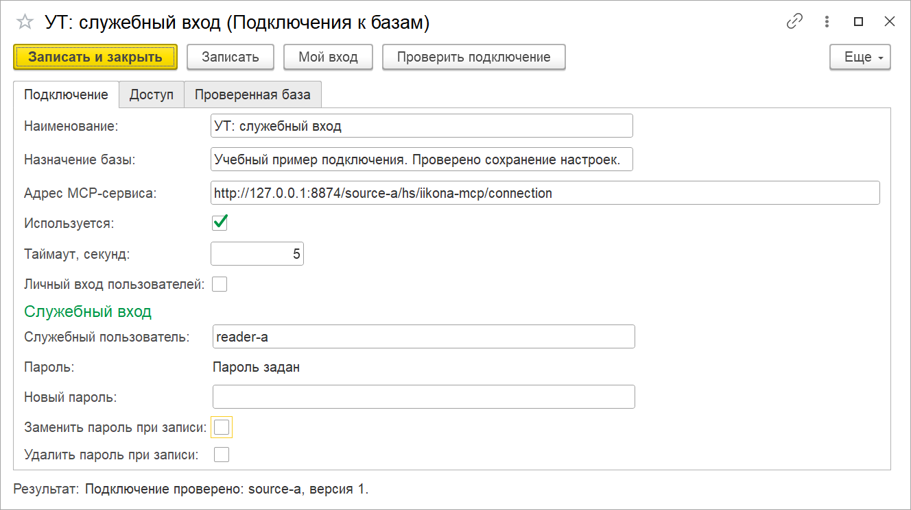
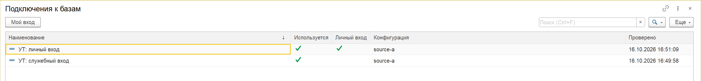
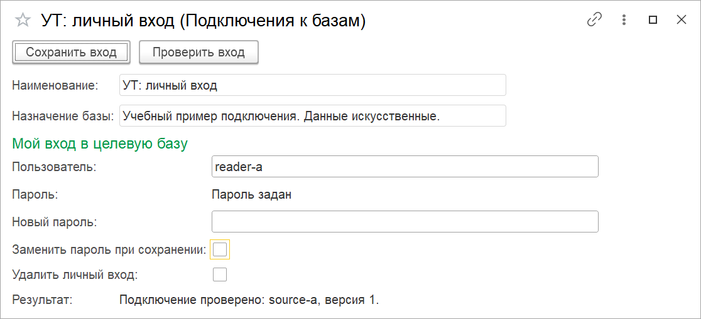
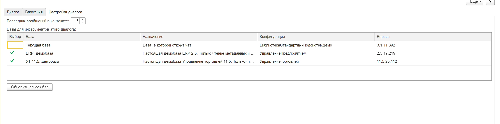
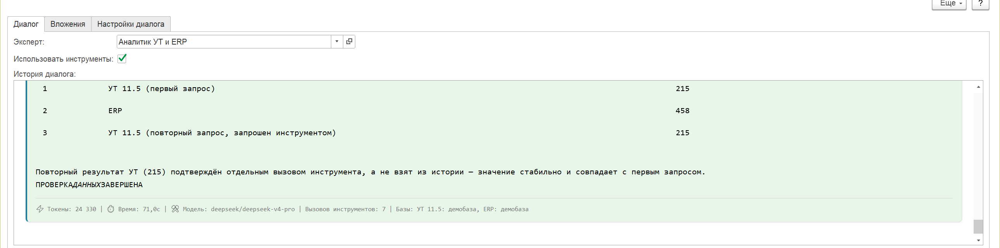
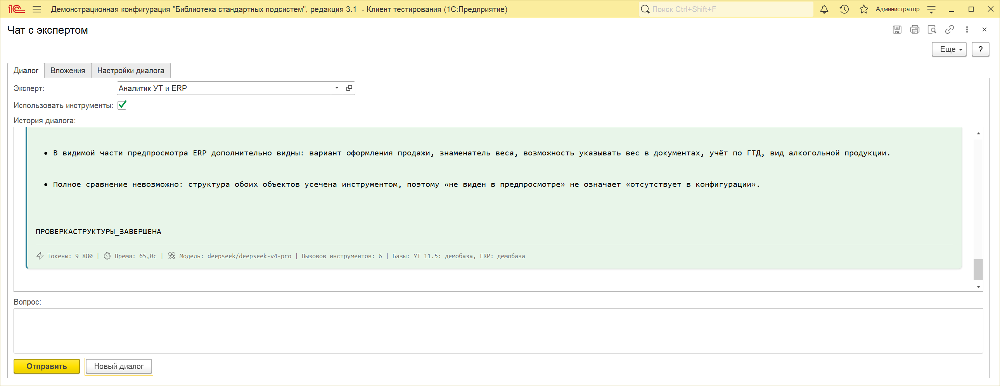

# Подключения к другим базам

Подключения доступны с версии 1.8.0. Центральная ИИкона управляет доступом к нескольким базам; агент выбирает источник для каждого вызова. Ниже приведены порядок настройки и примеры настоящих демобаз УТ 11.5 и ERP 2.5. [Состав итоговых проверок](../совместимость/README.md).

## Что нужно подготовить

В целевой базе устанавливается расширение ИИконы и публикуется его HTTP-сервис. Для нового подключения используется адрес `https://<сервер>/<публикация>/hs/iikona-mcp/connection`. Вход выполняется под пользователем целевой базы с его реальными правами. Учётную запись, профиль и группу доступа создают штатными средствами БСП. Права на чтение нужных данных задаются в целевой базе.

В центральной ИИконе администратор открывает список «Подключения к базам» и создаёт карточку. Укажите понятное наименование, назначение базы, адрес сервиса, таймаут и режим входа. На странице «Доступ» выберите пользователей или группы центральной базы, которым разрешено это подключение. Пользователь видит только выданные ему подключения.

На снимках учебный HTTP-источник с искусственными данными. Подпись «УТ» иллюстрирует наименование подключения; это ещё не снимок проверки настоящей УТ.

## Служебный вход

Оставьте «Личный вход пользователей» выключенным. Введите имя служебного пользователя целевой базы и новый пароль. Ввод пароля автоматически включает его замену при записи. Нажмите «Записать», затем «Проверить подключение».

Сохранённый пароль не загружается в форму. Надпись «Пароль задан» показывает только наличие секрета. Обычная запись карточки сохраняет прежний пароль. Для его изменения введите новый; для удаления отметьте отдельное действие. После записи поле нового пароля очищается.

Проверка идёт в фоне. Успех и отказ появляются в строке результата. Неверный пароль, отсутствие реквизитов или недоступность источника требуют исправления этого подключения. На странице «Проверенная база» находятся сведения, полученные от целевой базы при успешной проверке.

## Личный вход

Администратор включает «Личный вход пользователей» и записывает карточку. Каждый допущенный пользователь выбирает подключение в списке и нажимает «Мой вход». Та же команда доступна в карточке.

Введите свой логин и новый пароль целевой базы, нажмите «Сохранить вход», затем «Проверить вход». До проверки изменения нужно сохранить. Повторное открытие показывает собственный логин и состояние пароля; сохранённый пароль остаётся на сервере. Личный вход другого пользователя в эту форму не загружается.

Для изменения пароля введите новый. «Удалить личный вход» удаляет ваши реквизиты этого подключения. Служебные реквизиты при отказе личного входа автоматически не подставляются.

Пароли хранятся в безопасном хранилище БСП. Доступ администратора к файлу базы или её СУБД остаётся отдельной границей защиты. В опубликованной документации не размещайте реальные адреса внутренних систем, логины и секреты.

## Если проверка не проходит

| Результат | Что проверить |
| --- | --- |
| Сначала запишите подключение | В карточке есть несохранённые изменения либо она ещё не создана |
| Сначала сохраните изменения личного входа | Изменены логин, пароль или действие удаления |
| Не сохранены реквизиты | Служебный или ваш личный вход ещё не задан |
| HTTP 401 | Логин, пароль и штатную авторизацию публикации |
| HTTP 403 или отказ инструмента | Права пользователя целевой базы и доступ к подключению |
| Ошибка соединения | Адрес публикации, доступность сервера и таймаут |

## Выбор баз для вопроса в чате

Откройте «Чат с экспертом», перейдите на страницу «Настройки диалога». В таблице «Базы для инструментов этого диалога» отметьте нужные источники. Текущая база отмечена при открытии чата, подключённые базы выбираются явно. «Обновить список баз» перечитывает доступные подключения и сохраняет допустимые отметки. Снятие всех отметок оставляет вопрос без доступа инструментов к базам.

Вернитесь на страницу «Диалог», выберите эксперта с моделью, поддерживающей инструменты, и включите «Использовать инструменты». Укажите в вопросе, с какими базами нужно работать. Агент получает описания только выбранных доступных источников и указывает database_id при каждом вызове. Сохранённые адреса, логины и пароли в запрос модели не входят. Результаты инструментов проходят контроль персональных данных выбранной модели.

В метаинформации ответа перечисляются фактически использованные базы. При отказе источника запрос не переключается автоматически на другую базу. Выбор можно поменять перед следующим вопросом.

На этих двух снимках настоящие демобазы УТ 11.5.25.112 и ERP 2.5.17.219, модель DeepSeek V4 Pro внутри центральной 1С. УТ подключена со служебным входом, ERP с личным. Вопрос о данных вызвал семь инструментов; последовательность УТ → ERP → УТ дала 215 → 458 → 215. Числа сверены отдельно под теми же ограниченными пользователями. Они отражают доступные этим пользователям записи, а не весь объём базы.

## Пример анализа структуры

Попросите сравнить справочник «Номенклатура» в двух выбранных базах: сведения о конфигурации, дерево метаданных и структуру объекта. В проверенном диалоге модель выполнила шесть вызовов, по три для каждого источника.

Инструмент может усечь длинную структуру; ответ должен учитывать эту границу. Отсутствие поля в видимой части не доказывает, что его нет в конфигурации.

Список расширений у пользователя без административного доступа может быть недоступен. В кандидате dev12 инструмент различает `extensions_status=available` и `unavailable`; пустой массив при `unavailable` не означает отсутствия расширений. Права ради получения списка расширять не требуется. Снимки получены на dev11 до этого исправления; ошибочный вывод об отсутствии расширений из полного прежнего ответа не является подтверждённым фактом.

Реальные диалоги и снимки относятся к dev11; исправление отдельно прошло 162 выбранных YAxUnit и повторные HTTP-проверки настоящих баз на dev12. Это разные зафиксированные срезы. Итоговые проверки 1.8.0 перечислены на странице [совместимости](../совместимость/README.md); они не меняют версию исторических снимков.

В версии 1.8.0 также доступны [выбор инструментов модели](../настройка-моделей/README.md#инструменты-модели), [просмотр отправки и журнал текущего диалога](../контекст-чата/README.md).
